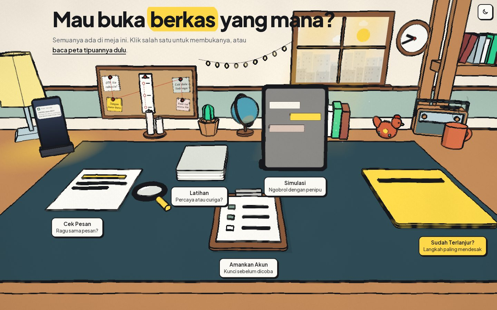
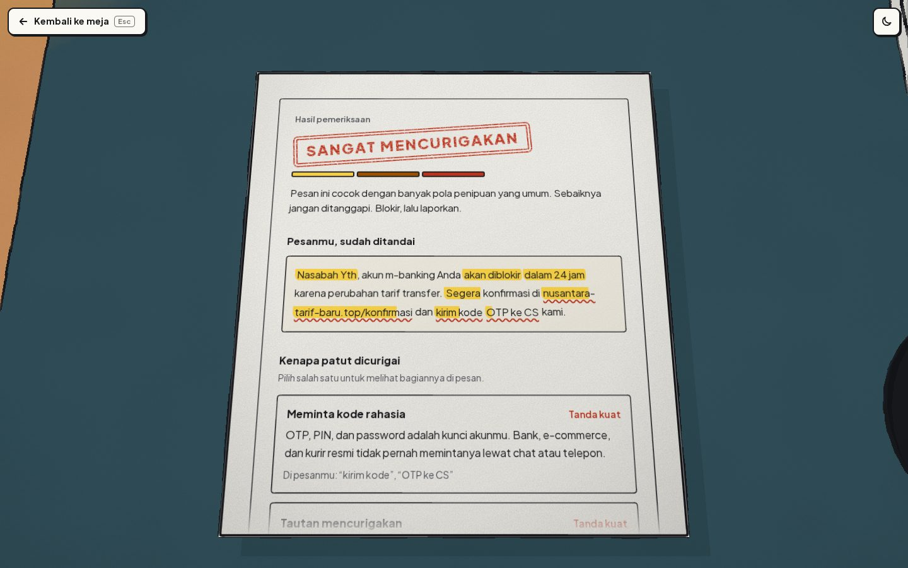
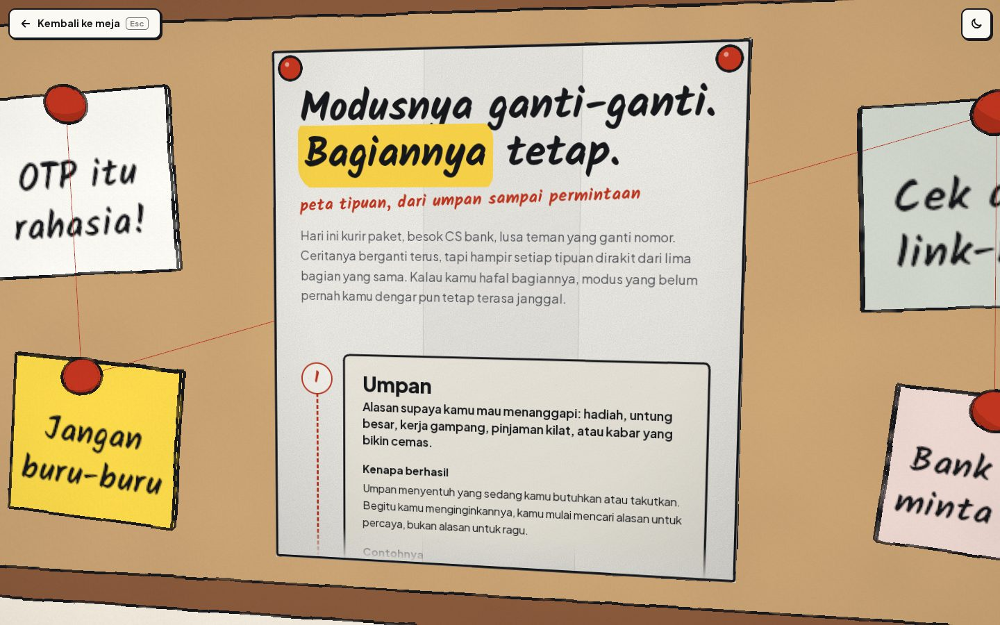
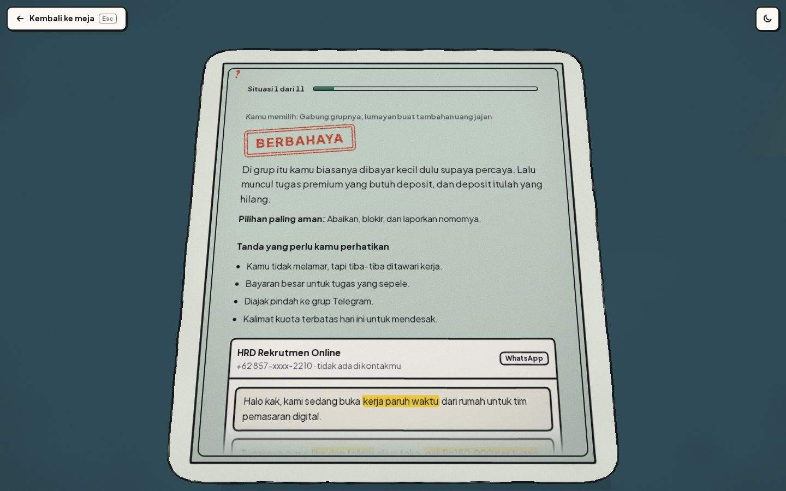
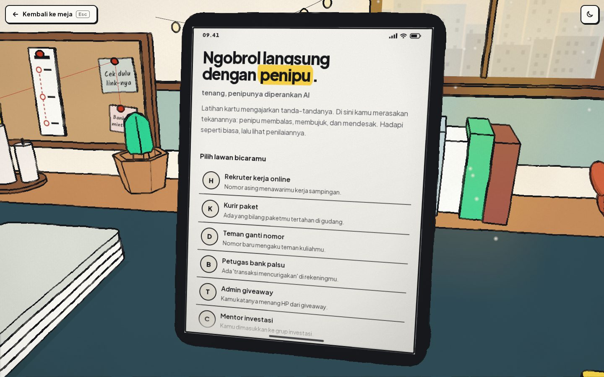
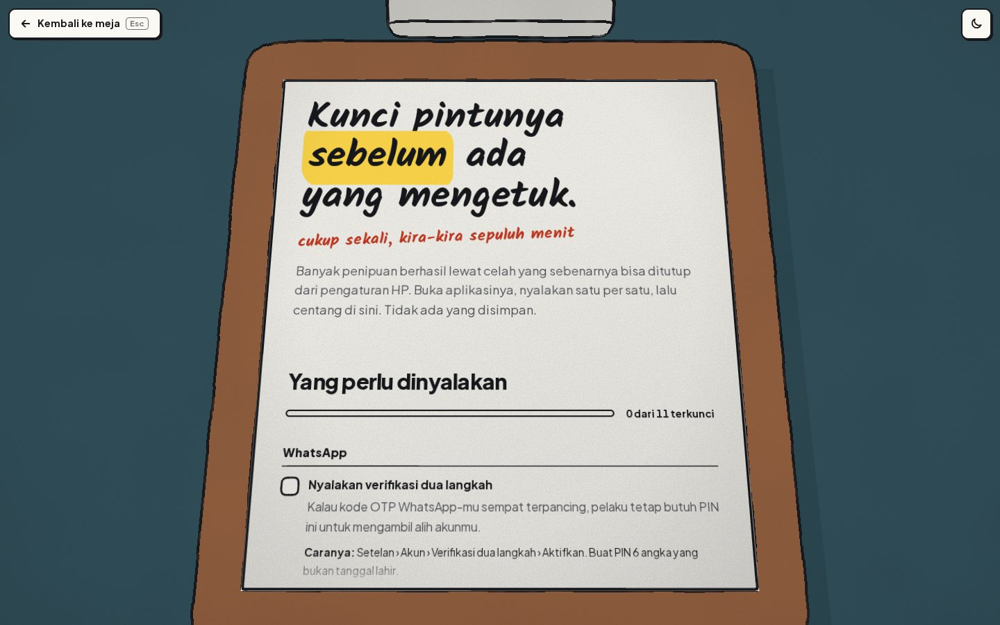
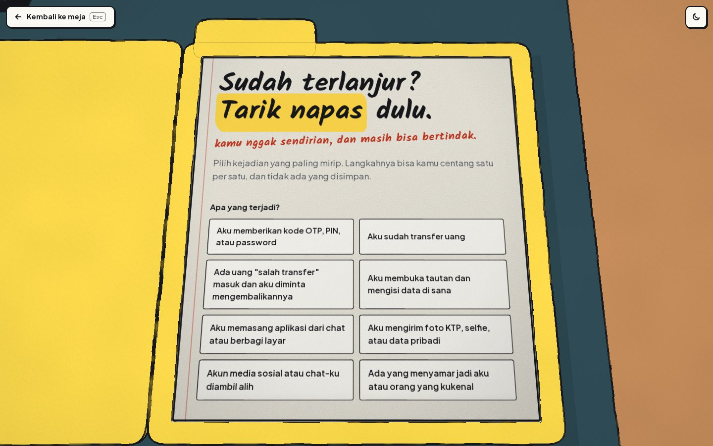
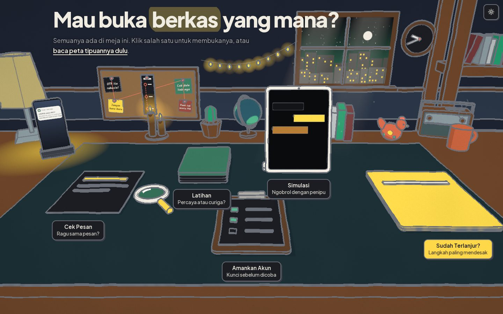
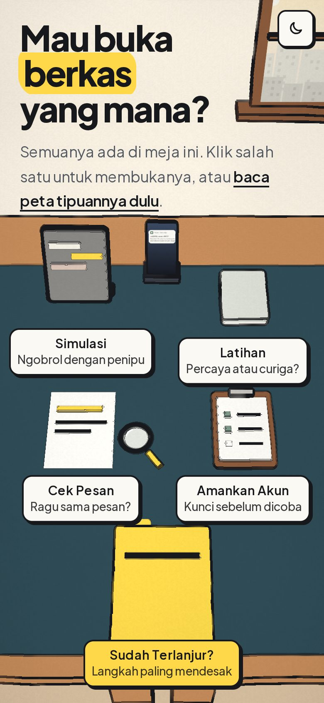
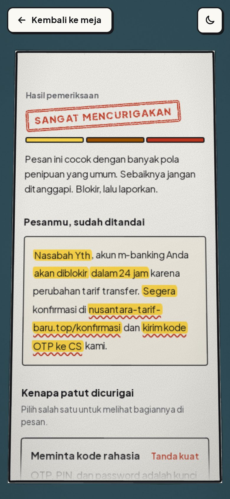

# Clarity

Aplikasi web untuk studi kasus **The Trust Trap: Navigating Digital Deception** (Web Development MIT-Week 2026, tema
*Guardians of the Digital Space*). Membantu anak muda Indonesia mengenali tipuan digital, berlatih mengambil keputusan, dan
tahu langkah yang harus diambil kalau sudah terlanjur, lalu meneruskan peringatannya ke teman dan keluarga.



| | |
| --- | --- |
| **Live deployment** | [https://clarity.arpthef.my.id/](https://clarity.arpthef.my.id/) |
| **Video demo** (maks. 5 menit) | [https://youtu.be/2LXWugoGrGk](https://youtu.be/2LXWugoGrGk) |
| **Repositori** | [github.com/Ariffansyah/clarity](https://github.com/Ariffansyah/clarity) |
| **Dokumentasi teknis** | [docs/TEKNIS.md](docs/TEKNIS.md) |

**Tim:** Linus Wannabe

| Nama | Peran |
| --- | --- |
| _Mohammad Ariffansyah_ | Ketua tim |
| _Nailah Salsabila Ramadhani Kusnadi_ | _Anggota_ |

## Mencoba dalam satu menit

1. Buka tautan live. Halaman depan adalah meja berisi berkas; klik berkasnya atau labelnya untuk membukanya.
2. Buka **Cek Pesan**, lalu klik salah satu contoh pesan fiktif (langsung diperiksa), atau tempel pesanmu sendiri dan tekan
   **Periksa pesan**.
3. Hasilnya: bagian yang mencurigakan ditandai stabilo, tiap tanda dijelaskan alasannya, tautannya dicek, dan ada langkah
   aman yang bisa langsung dilakukan. Hasil bisa dikirim ke keluarga lewat WhatsApp.
4. Kalau mau, tekan **Kirim ke AI** untuk pendapat kedua. Teks yang akan dikirim bisa dilihat dulu, sudah disamarkan.
5. Lanjut ke **Latihan** (pilih tindakan untuk 11 situasi), **Simulasi** (ngobrol dengan penipu fiktif, lalu dinilai), atau
   **Sudah Terlanjur?** (pilih kejadiannya, ikuti daftar periksanya).

Semua alamat bisa dibuka langsung (`/periksa`, `/latihan`, dan seterusnya) dan tampil sebagai halaman penuh. Kalau
browser tidak mendukung WebGL, meja 3D tidak tampil dan berkasnya menjadi daftar tombol biasa.

## Tampilan

| | |
| --- | --- |
|  |  |
| **Cek Pesan.** Bagian yang mencurigakan ditandai, tiap tanda dijelaskan. | **Peta Tipuan.** Umpan, kedok, desakan, isolasi, permintaan. |
|  |  |
| **Latihan.** Kartu berbalik dan menjelaskan pilihanmu. | **Simulasi.** Pilih lawan bicara, ngobrol, lalu dinilai. |
|  |  |
| **Amankan Akun.** Pengaturan yang menutup celah, dicentang satu per satu. | **Sudah Terlanjur?** Pilih kejadiannya, ikuti langkahnya. |
|  |   |
| **Tema gelap**, mengikuti pengaturan sistem. | **Di HP**, meja dan hasil pemeriksaan menyesuaikan layar. |

## Fitur

| Halaman | Pendekatan | Isi |
| --- | --- | --- |
| `/` Meja | Pintu masuk | Tumpukan berkas di atas meja. Klik berkasnya atau sticky note-nya, fiturnya terbuka di pop-up hape. Alamatnya tetap bisa dibagikan: dibuka langsung, tampil sebagai halaman penuh. |
| `/periksa` Cek pesan | Recognize | Tempel pesan atau tautan. Bagian yang mencurigakan ditandai stabilo, tiap tanda dijelaskan alasannya, tautan dicek (tautan pendek, akhiran domain murah, nama merek palsu, file `.apk`, IP, punycode), juga modus yang lebih baru: CS palsu minta berbagi layar, salah transfer, scan QRIS untuk "menerima" uang, dan kabar darurat keluarga yang suaranya bisa ditiru AI. Lalu diberi langkah aman, dan hasilnya bisa dikirim ke keluarga lewat WhatsApp. |
| `/peta` Peta tipuan | Understand | Modusnya ganti-ganti, bagiannya tetap: umpan, kedok, desakan, isolasi, dan permintaan. Tiap bagian diberi definisi, alasan kenapa berhasil, contoh fiktif yang ditandai stabilo, dan cara mematahkannya. Hasil Cek Pesan menautkan ke bagian yang cocok (`/peta#desakan`). Di meja, petanya terlipat dan tersemat di papan pin; diklik, lipatannya terbuka. Di HP papan pinnya tidak tampil, jadi petanya dibuka lewat kalimat pengantar di halaman depan dan terbuka di lembar cek pesan. |
| `/latihan` | Learn | 11 situasi fiktif (9 penipuan, 2 wajar). Pilih tindakan, kartu berbalik menunjukkan umpan balik dan pesan yang sudah ditandai. Skor di akhir. |
| `/amankan` Amankan akun | Prevent | Papan klip berisi 11 pengaturan yang menutup celah sebelum penipu datang (verifikasi dua langkah WhatsApp, bisukan penelepon tak dikenal, larang APK dari luar Play Store, limit transfer, dan lainnya), masing-masing dengan alasan dan cara menyalakannya. Plus usulan kata sandi keluarga untuk melawan suara tiruan AI, dengan pesan grup keluarga yang sengaja tidak memuat katanya. Tidak ada yang disimpan. |
| `/bertindak` | Act | Daftar periksa per kejadian (OTP bocor, sudah transfer, salah transfer, buka tautan palsu, pasang APK atau berbagi layar, kirim KTP, akun dibajak, ditiru), penyusun pesan peringatan untuk teman, dan saluran lapor resmi. |
| `/simulasi` | Learn (AI) | Ngobrol dengan penipu fiktif yang diperankan AI (7 persona), maksimal 8 balasan, lalu dinilai: aman, hampir kena, atau kena, beserta alasannya. |
| `/periksa` Tanya AI | Recognize (AI) | Setelah pemeriksaan berbasis aturan, pengguna bisa meminta pendapat kedua dari AI. Kutipan AI yang tidak ada di pesan dibuang, jadi setiap sorotan menunjuk teks asli. |

## Kenapa ini menjawab studi kasus

Studi kasus meminta pengguna menjadi *guardian*: mengenali tipuan, belajar mengambil keputusan lebih aman, lalu bertindak
untuk diri sendiri dan orang lain. Clarity mengikuti urutan itu.

- **Saat ragu (Recognize).** Cek Pesan menjawab pertanyaan "ini tipuan bukan?" pada saat pesannya masih di depan mata,
  dengan alasan yang bisa dipahami, bukan sekadar skor.
- **Sebelum kejadian (Learn).** Latihan dan Simulasi melatih keputusan di situasi yang mirip aslinya, termasuk dua situasi
  yang wajar, supaya pengguna tidak sekadar curiga pada semua pesan.
- **Setelah kejadian (Act).** Sudah Terlanjur? mengurutkan langkah dari yang paling mendesak dan menunjuk saluran lapor resmi.
- **Pendekatan tambahan: Understand.** Penipu terus mengganti cerita, tapi bagiannya sama (umpan, kedok, desakan, isolasi,
  permintaan). Peta Tipuan mengajarkan bagian-bagian itu, jadi pengguna bisa mengenali modus yang belum pernah ia lihat,
  bukan hanya yang ada di daftar.
- **Pendekatan tambahan: Prevent.** Amankan Akun menutup celah sebelum penipu datang, karena banyak tipuan (APK, OTP,
  suara tiruan) gagal kalau pengaturan HP dan rekening sudah dikunci.
- **Melindungi orang lain.** Hasil Cek Pesan bisa dikirim ke keluarga, penyusun pesan peringatan menyiapkan kabar untuk
  teman, dan kata sandi keluarga melindungi orang tua dari telepon "anakmu kecelakaan" dengan suara tiruan AI.

## Panduan penilaian

Tempat melihat tiap aspek di Juknis:

| Aspek | Yang bisa dicek |
| --- | --- |
| Fungsionalitas | Tujuh halaman di tabel [Fitur](#fitur), semua bisa dibuka langsung lewat alamatnya. Tanpa kunci AI atau tanpa WebGL, fitur lain tetap jalan. |
| Kesesuaian studi kasus | [Kenapa ini menjawab studi kasus](#kenapa-ini-menjawab-studi-kasus): Recognize, Learn, Act, ditambah Understand dan Prevent. |
| UI/UX | Lihat [Tampilan](#tampilan). Bisa dipakai dari HP sampai desktop, tema terang dan gelap mengikuti sistem, animasi berkurang kalau `prefers-reduced-motion` aktif, dan setiap hasil diberi alasan, bukan sekadar skor. |
| Kualitas kode | Konten dipisah dari tampilan di `lib/`, 16 uji unit (`pnpm test`), tanpa dependensi selain Next.js, React, dan three.js. Struktur dan cara menambah konten ada di [dokumentasi teknis](docs/TEKNIS.md). |
| Dokumentasi | README ini dan [docs/TEKNIS.md](docs/TEKNIS.md): arsitektur, cara penilaian pesan, kontrak API, keamanan, pengujian, dan keputusan desain. |

## Cara kerja dan batasannya

- Penilaian memakai aturan (regex dan pengecekan alamat) di `lib/analyze.ts`. Setiap aturan punya alasan yang ditampilkan ke pengguna.
- Hasil **bukan bukti**. "Belum ada pola yang cocok" tidak berarti aman, dan aplikasi menyatakannya di layar.
- Pemeriksaan berbasis aturan berjalan di browser dan tidak mengirim apa pun.
- Fitur AI (Tanya AI dan Simulasi) mengirim teks ke [Groq](https://groq.com) **hanya setelah pengguna menekan tombol**, dan ini dijelaskan di layar. Nomor, angka panjang, dan email disamarkan di browser lalu disamarkan ulang di server (`lib/ai.ts`). Clarity tidak menyimpan teks atau percakapan.
- Satu-satunya yang disimpan adalah pilihan tema terang atau gelap, di `localStorage` browser pengguna.
- Tanpa kunci API, fitur AI tampil nonaktif dan fitur lain tetap jalan.
- Semua contoh dan skenario fiktif. Tidak ada tautan berbahaya yang bisa diklik.

## Teknologi dan sumber pihak ketiga

| Sumber | Dipakai untuk | Lisensi |
| --- | --- | --- |
| [Next.js 16](https://nextjs.org), [React 19](https://react.dev) | Kerangka aplikasi dan API route | MIT |
| [Tailwind CSS 4](https://tailwindcss.com) | Gaya tampilan | MIT |
| [three.js](https://threejs.org) | Meja 3D di halaman depan | MIT |
| [Furniture Kit oleh Kenney](https://kenney.nl/assets/furniture-kit) | Model meja, rak, lampu, tanaman, radio (`public/models/kenney`) | CC0 |
| [Plus Jakarta Sans](https://fonts.google.com/specimen/Plus+Jakarta+Sans), [Kalam](https://fonts.google.com/specimen/Kalam) | Huruf utama dan tulisan tangan | SIL OFL |
| [Groq API](https://groq.com), model `openai/gpt-oss-120b` | Pendapat kedua AI dan pemeran penipu di Simulasi | Layanan pihak ketiga |

## Dokumentasi teknis

Arsitektur, struktur folder, cara Cek Pesan menghitung skor, kontrak API, langkah keamanan, cara menambah aturan atau
skenario, dan pengujian ada di [docs/TEKNIS.md](docs/TEKNIS.md).

## Menjalankan

Butuh Node.js 22.18+ (supaya `pnpm test` bisa langsung menjalankan file `.ts`) dan pnpm. Fitur AI butuh kunci dari [console.groq.com](https://console.groq.com). Salin contohnya ke
`.env.local` (tidak ikut di-commit), lalu isi `GROQ_API_KEY`:

```bash
cp .env.example .env.local
```

```bash
pnpm install
pnpm dev     # http://localhost:3000
pnpm test    # 16 uji unit: aturan pendeteksi, peta, tata letak meja
pnpm lint
pnpm build && pnpm start   # versi produksi di http://localhost:3000
```

| Variabel | Wajib | Isi |
| --- | --- | --- |
| `GROQ_API_KEY` | Tidak | Menyalakan Tanya AI dan Simulasi. Kosong berarti keduanya nonaktif. |
| `GROQ_MODEL` | Tidak | Model Groq. Bawaannya `openai/gpt-oss-120b`. |

Untuk deploy (misalnya Vercel), impor repositori ini lalu isi `GROQ_API_KEY` di pengaturan environment variable.
